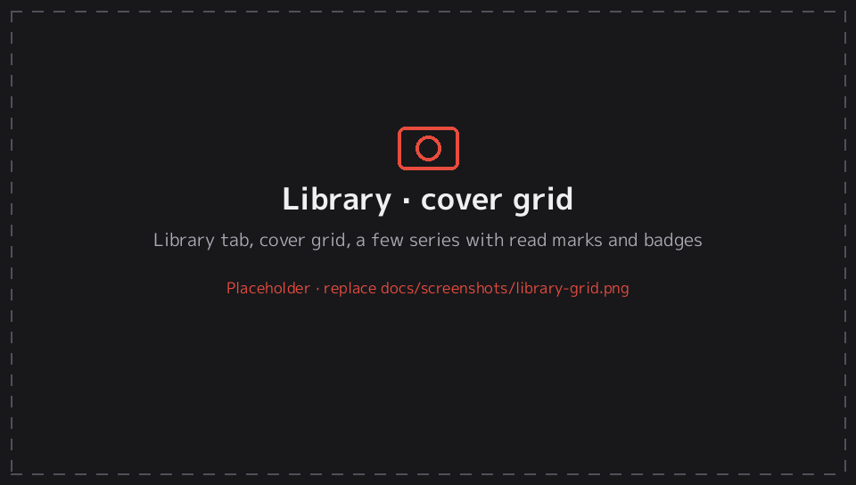
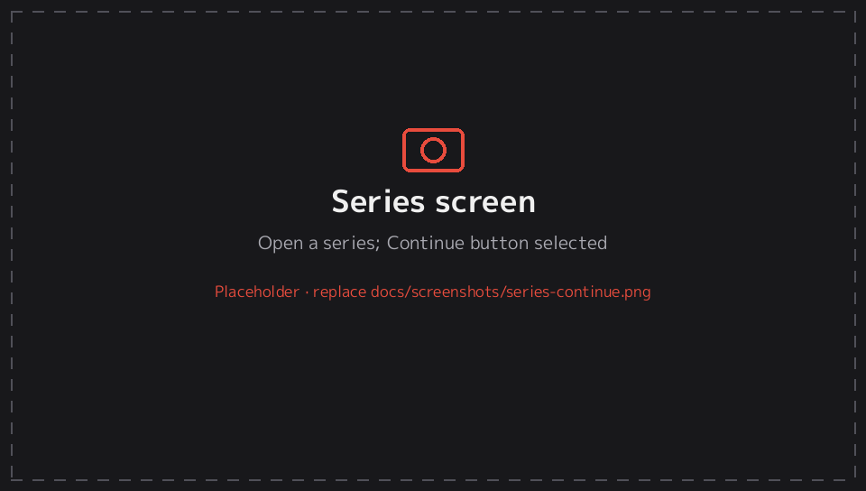
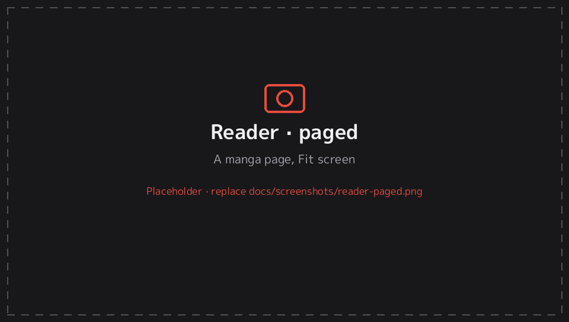
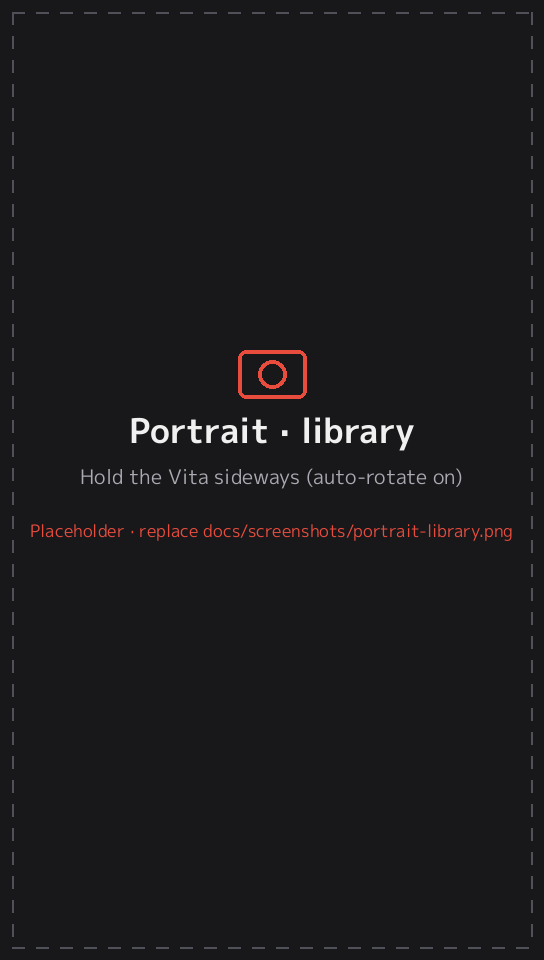
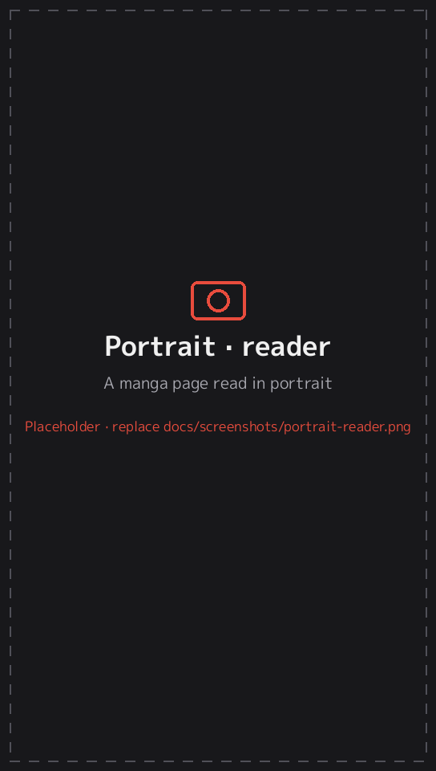
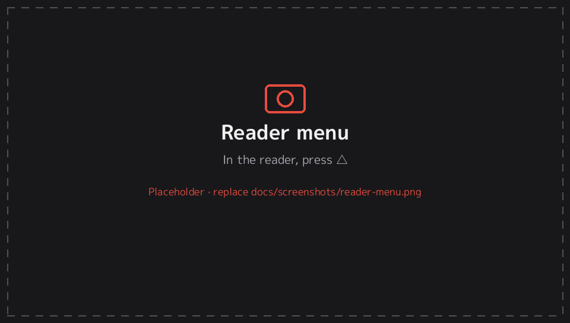

<p align="center"></p>

<h1 align="center">EnManga</h1>

<p align="center">A minimalist manga and comic reader for the PS Vita, made for reading your own offline collection.<br>
Based on <a href="https://github.com/Creckeryop/NOBORU">NOBORU</a>, with features inspired by <a href="https://github.com/komikku-app/komikku">Komikku</a>.</p>

<p align="center">


</p>

**[⬇ Download](../../releases)** · **[📘 Documentation](docs/README.md)** · **[📝 Changelog](CHANGELOG.md)** · **[🐞 Report a bug](../../issues/new/choose)**

> **Heads-up:** EnManga is a hobby project and was *vibe coded*: almost all of the code and documentation was written by an AI assistant under my direction. I test every build on my own Vita, but expect bugs. See [About this project](#about-this-project-and-ai-use).



## Features

### 📚 Library
- **One cover per series**, from a `cover.jpg` in the folder or the first volume. → [Series covers](docs/getting-started.md#series-covers)
- **Animated GIF covers:** a `cover.gif` plays when selected, always, or never. → [Animated covers](docs/getting-started.md#animated-gif-covers)
- **Understands messy collections:** loose `Vagabond v01.cbz … v14.cbz` files become one series, shelf folders are recognised, and `Vagabond, v02 [2002] [Viz]` is shown as **Vol. 2**. → [Folder layouts](docs/getting-started.md#folder-layouts)
- **Cover grid, compact grid or list**, with sorting, filters (unread, in progress, completed, bookmarked), search and categories. → [Library](docs/library.md)
- **History** with one-tap resume.

### 📖 Series screen
- A **Continue** button that takes you back to the exact page you left.
- A volume grid with **read marks**, progress bars and a **Next** tag.
- **Volume preview** with the full original file name. → [Series screen](docs/series.md)
- Views, sorting and filters remembered **per series**.

| Series screen | Reader |
|---|---|
|  |  |

### 🔍 Reader
- **Reading modes:** right to left, left to right, vertical, webtoon, and long strip with **auto-scroll**.
- **Scale and fit:** fit screen, width or height, smart fit, original and stretch, plus a zoom start position. → [Fitting and scaling](docs/reader.md#fitting-and-scaling-paged-modes)
- **Page layout:** two-page spreads, splitting or rotating wide pages, cropping white or black borders, and trimming margins.
- **Zoom and pan:** pinch, double-tap or the sticks, with zoom remembered per page.
- **Your colours:** Dark, Black or Light theme, with an **accent colour** chosen from 12 presets or any custom colour using a colour picker. → [Accent colour](docs/settings.md#accent-colour)
- **Comfort:** page tone (sepia, warm…), colour filters including a night filter, brightness (also by sliding a finger along the screen edge) and background colour.
- **Tap zones:** four layouts plus your own **custom 3×3 grid**.
- **Extras:** page bookmarks, chapter transitions, reading statistics. → [Reader](docs/reader.md)

### 🎛️ Presets
- **Built-in presets** (Manga, Comic, Webtoon, …) and your own, applied per series or as the default.
- EnManga can **ask how to read** the first time you open a series. → [Presets](docs/presets.md)

### 🔄 Portrait mode, auto-rotate and rear touchpad
- The **whole app** works held sideways like a book, in either direction, with layouts made for it.
- **Auto-rotate** with the motion sensor, a **rotation lock** by the clock, and the last orientation remembered.
- **Rear touchpad:** tap to turn the page, drag to scroll. In portrait only the top half responds, so your hand can rest on the bottom half. → [Portrait mode](docs/orientation.md)

| Portrait library | Portrait reader | Reader menu |
|---|---|---|
|  |  |  |

### 🛠️ Tools for your computer
- **EnManga Converter:** a one-file web page that converts **WebP** manga (which the Vita can't show) to JPG, offline. → [Converter](docs/converter.md)
- **EnManga Cover Animator:** turns a still cover into a small, gently animated `cover.gif`, sized to play on the Vita. Whole-cover effects (shine, sparkle, breathe…), or **Character mode**: mark the eyes, hair or chest (box, lasso, or **auto-detect** for anime faces) and they blink, sway and breathe, with any of the other effects on top. → [Cover Animator](docs/cover-animator.md)

## Install

1. A Vita or PS TV with **HENkaku / Ensō** and **VitaShell**.
2. Download **`EnManga-Beta-v1.0.vpk`** from [Releases](../../releases).
3. Copy it to the Vita, select it in VitaShell, and install it.
4. Put your manga in **`ux0:manga/`** (or `ux0:data/enmanga/import/`) and start EnManga.

Full instructions: [Getting started](docs/getting-started.md).

## Documentation

| | |
|---|---|
| [Getting started](docs/getting-started.md) | Install, folders, file types, covers, names |
| [Library](docs/library.md) | Layouts, sorting, filters, search, categories, history |
| [Series screen](docs/series.md) | Continue, volume grid, preview, per-series views |
| [Reader](docs/reader.md) | Every reading option explained |
| [Presets](docs/presets.md) | Built-in and custom presets, per-series settings |
| [Portrait and rear touchpad](docs/orientation.md) | Auto-rotate, lock, reader orientation, rear pad |
| [Controls](docs/controls.md) | Every button, screen by screen |
| [Settings reference](docs/settings.md) | Every setting with its default |
| [Converter](docs/converter.md) | WebP → JPG on your computer |
| [Troubleshooting & FAQ](docs/troubleshooting.md) | Common problems, logs, data, resetting |
| [Cover Animator](docs/cover-animator.md) | Make animated GIF covers |

## Status and known limitations

EnManga is in **beta**. It works well on my own Vita for my own library, but it hasn't been tried on many setups yet.

- **Formats:** CBZ/ZIP and folders of JPG, PNG, BMP or GIF. No CBR/RAR, 7z, PDF or EPUB. WebP needs converting first (the Vita runtime can't decode it).
- **Local files only:** there are no online sources and there never will be.
- **Text in portrait** comes from built-in glyph sheets: Latin, kana and about 6,000 common kanji. Rarer characters show as □ there; landscape shows everything.
- **The on-screen keyboard** is the system one, so it always opens in landscape.
- **Sensors:** the auto-rotate direction and the rear touchpad side were confirmed on my own Vita. If yours behave the other way round, there are switches for both in Settings → Screen & controls.

Found a problem? [Open an issue](../../issues/new/choose) and attach `ux0:data/enmanga/log.txt` if there is one.

## About this project and AI use

I wanted a manga reader for my Vita with lots of settings to tweak, so I made one. EnManga was **built with an AI assistant (Anthropic's Claude)**:

- **The code** (the Lua app, the build and glyph tools, the Converter and the Cover Animator) was written by the AI from my descriptions, feature requests and bug reports.
- **The documentation**, the README and the changelog were written the same way.
- **The logo and icon** were generated in code by the AI from my description.
- **Testing:** every feature was exercised in a simulated Vita runtime during development (automated tests, fuzzing, low-memory runs). I then tested the builds on a real PS Vita and reported back what didn't work. Things that only show up on real hardware can still slip through.
- **What I did:** decided what to build, tried it on the console, and kept asking for changes until it worked the way I wanted.

I'm sharing it because it's useful to me and might be to someone else. If you're a Vita developer and spot something done badly, issues and pull requests are very welcome.

## Building from source

The app is Lua running on NOBORU's build of [lua-player-plus (lpp-vita)](https://github.com/Rinnegatamante/lpp-vita), so there's nothing to compile. A VPK is just a ZIP of the `app/` folder:

```sh
python3 tools/build_vpk.py        # creates dist/EnManga-Beta-v1.0.vpk
```

| Path | Contents |
|---|---|
| `app/eboot.bin` | The Lua runtime (NOBORU's lpp-vita build) |
| `app/index.lua`, `app/main.lua` | Startup and main loop |
| `app/assets/libs/` | App code: scanner, library, series screen, reader, UI, orientation |
| `app/assets/glyphs/` | Pre-rendered font pages for sideways text in portrait mode |
| `app/sce_sys/` | Icon, LiveArea and `param.sfo` (title and version) |
| `tools/mkglyphs.py` | Regenerates `assets/glyphs` (needs Pillow and fontTools) |
| `converter/` | The WebP → JPG converter and the Cover Animator |
| `docs/` | Documentation and screenshots |

## Credits and license

- **[NOBORU](https://github.com/Creckeryop/NOBORU)** by Creckeryop. EnManga uses NOBORU's runtime and its image-loading code, and follows its app structure. The library, reader and everything else were written new for EnManga.
- **[lpp-vita](https://github.com/Rinnegatamante/lpp-vita)** by Rinnegatamante: the Lua interpreter for the Vita.
- **[Komikku](https://github.com/komikku-app/komikku)**: inspiration for features and design.
- **M+ fonts** (The M+ Project Authors), under the SIL Open Font License; see `app/assets/fonts/OFL.txt`.
- **[lbpcascade_animeface](https://github.com/nagadomi/lbpcascade_animeface)** by nagadomi (MIT License): the anime face detector built into the Cover Animator.

EnManga is released under the **GNU General Public License v3.0**, the same as NOBORU ([LICENSE](LICENSE)). Contributions: see [CONTRIBUTING.md](CONTRIBUTING.md).
It reads files you already own. It doesn't download or include any manga.
