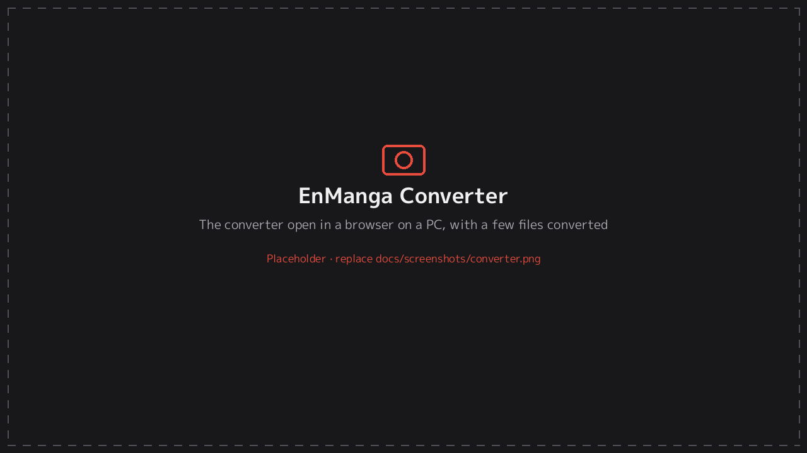

# 9. EnManga Converter

[← Documentation](README.md)

Many digital releases use **WebP** images, which the Vita can't decode. **EnManga Converter** is a single web page, [`converter/EnManga-Converter.html`](../converter/EnManga-Converter.html), that rewrites those pages as JPG on your computer.

- It works offline in Chrome, Edge, Firefox or Safari.
- **Nothing is uploaded.** Everything happens inside your browser.

## How to use it

1. Download `EnManga-Converter.html` (from the Release, or from the `converter/` folder) and double-click it.
2. Drop `.cbz` / `.zip` files or whole manga folders onto the page, or use **Choose CBZ / ZIP files** or **Choose a folder**.
3. Wait for each row to finish, then:
   - **Save** each file individually, or
   - **Save all as one ZIP**, which keeps your series folders.
4. Copy the results to the Vita:
   - Single files go into `ux0:manga/<Series name>/`.
   - The combined ZIP: extract it into `ux0:manga/`.
5. In EnManga, press △ → **Rescan library**.

## What it changes

| Input | Result |
|---|---|
| WebP, AVIF and JPEG XL pages | Converted to JPG |
| JPG, PNG, GIF and BMP pages | Kept as they are (PNG can optionally be converted) |
| Files named `.jpg` that are really WebP | Detected and converted |
| A folder of images | Becomes one chapter `.cbz`, named after the folder, inside its series folder |
| Japanese (Shift-JIS) file names inside zips | Decoded correctly |
| Mac junk files (`__MACOSX`, `._*`, `.DS_Store`) | Removed |

Pages keep their names (only the extension changes), so the page order stays the same.

## Options

| Option | Default | Notes |
|---|---|---|
| JPG quality | 90 (70–98) | Lower values give smaller files with slightly softer images |
| Shrink pages wider than | never | 2048, 1600 or 1280 px. Useful for very large double-page scans. |
| Also convert PNG pages | Off | Makes colour and greyscale PNG scans much smaller |

Converted files are usually a bit larger than the WebP originals. That's normal: JPG compresses less efficiently than WebP.

---
[← 8. Settings reference](settings.md) · Next: [10. Troubleshooting →](troubleshooting.md)
