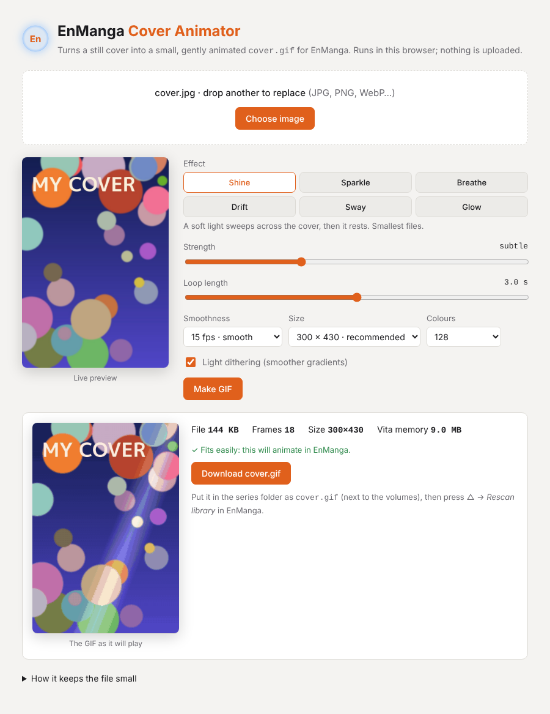
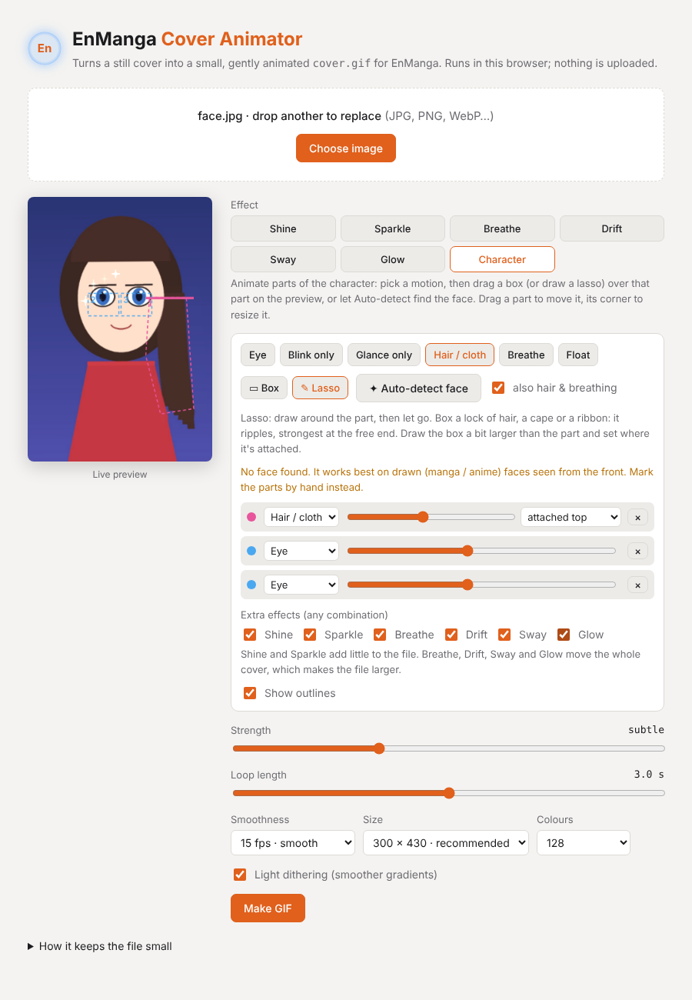

# 11. EnManga Cover Animator

[← Documentation](README.md)

[`converter/EnManga-Cover-Animator.html`](../converter/EnManga-Cover-Animator.html) turns a still cover into a small, gently animated `cover.gif` for [animated GIF covers](getting-started.md#animated-gif-covers). It's a single page that works offline in any modern browser, and nothing is uploaded.

## How to use it

1. Open `EnManga-Cover-Animator.html` (double-click it).
2. Drop in a cover image (JPG, PNG, WebP…) or press **Choose image**.
3. Pick an effect and adjust it while watching the live preview.
4. Press **Make GIF**. The result shows the file size, the number of frames, and how much memory it will need on the Vita.
5. Press **Download cover.gif** and copy it into the series folder, next to the volumes.
6. In EnManga, press △ → **Rescan library**.

## Effects

| Effect | What it does | File size |
|---|---|---|
| **Shine** | A soft light sweeps across the cover, then it rests | Small |
| **Sparkle** | A few small stars twinkle over the brightest parts | Smallest |
| **Breathe** | A slow, slight zoom in and out | Medium |
| **Glow** | Gently brightens and dims | Medium |
| **Sway** | A tiny back-and-forth tilt | Medium |
| **Drift** | A slow pan, like a camera move | Largest |
| **Character** | Animates parts of the character you mark: eyes blink and glance, hair sways, the chest breathes | Small |

## Character mode

Instead of moving the whole cover, **Character** moves only the parts you mark. Everything else stays perfectly still, which also keeps the file small (typically 40–90 KB).

1. Choose **Character**.
2. Pick a motion, then mark the part on the preview:
   - **▭ Box:** drag a rectangle over it.
   - **✎ Lasso:** draw around it freehand and let go. The motion then stays inside that exact shape, with a soft edge, which is best for a lock of hair or a cape that isn't rectangular.
3. Or press **✦ Auto-detect face** (see below) and adjust what it finds.
4. Fine-tune each part in the list: change its motion, its amount (slider), and for hair or cloth, the side it's attached on. Remove a part with **×**, or select it and press Delete.
5. On the preview, drag a part to move it, or drag its corner to resize it. Turn off **Show outlines** to see the result without them.

| Motion | Box… | What happens |
|---|---|---|
| **Eye** | one eye, just below the eyebrow, with a little skin either side | Blinks once per loop and glances left and right. Mark each eye separately; they blink together. |
| **Blink only** / **Glance only** | one eye | Just one of the two |
| **Hair / cloth** | a lock of hair, a cape, a ribbon, a bit larger than the part | A gentle ripple, strongest at the free end. Set where it's attached (top, bottom, left, right). |
| **Breathe** | the chest and shoulders | Rises and falls very slightly |
| **Float** | a small floating thing: a petal, an aura, a sword | Bobs up and down |

### Auto-detect

**✦ Auto-detect face** looks for drawn (manga / anime) faces on the cover and adds parts for you:
- **Eyes:** an *Eye* part on each eye of every face it finds (up to three faces, biggest first).
- **Hair and breathing** (with *also hair & breathing* ticked): a *Hair / cloth* part where hair hangs beside the face (only where hair-coloured pixels are actually found), and a *Breathe* part on the chest below the main face. These are rough guesses; check them.

It takes about a second and runs entirely in the browser. It uses the [lbpcascade_animeface](https://github.com/nagadomi/lbpcascade_animeface) face detector by nagadomi (MIT License), built into the page. In testing on 36 varied anime illustrations it found the face in 31, and placed the eyes correctly on nearly all of those. It misses faces that are small, turned sideways or partly hidden, and it's not made for photos or realistic art. Always check the outlines; anything it gets wrong can be moved, resized or removed like a part you drew yourself.

### Extra effects

Any of the whole-cover effects can be added on top of the character's motions, in any combination: **Shine**, **Sparkle**, **Breathe**, **Drift**, **Sway** and **Glow**. For example, blinking eyes with Sparkle, or swaying hair with a slow Drift.
- **Shine** and **Sparkle** add little to the file.
- **Breathe, Drift, Sway** and **Glow** move or tint the whole cover, so every pixel changes and the file gets much bigger (several hundred KB).

The main **Strength** slider scales every part and every extra effect at once.

**Limits:** Character mode moves the pixels that are already there. A blink draws the eyelids in the skin colour around the eye, with a lash line in the eye's darkest colour, so it suits drawn manga and anime eyes better than photos. Big movements, like turning the head or opening the mouth, aren't possible.

## Options

| Option | Default | Notes |
|---|---|---|
| Strength | subtle | From *barely* to *max* |
| Loop length | 3.0 s | 1–5 seconds per loop |
| Smoothness | 15 fps | 6 fps gives the smallest files; 20 fps is smoothest but uses the most memory |
| Size | 300 × 430 | The size EnManga's covers are shown at. 240 × 344 is smaller; 360 × 516 is sharper on the series screen. |
| Colours | 128 | 32 or 64 make smaller files; 256 gives the best gradients |
| Light dithering | On | Smooths colour banding in gradients |

## Will it animate on the Vita?

The result panel shows **Vita memory**: how much video memory all the frames take on the console. EnManga animates a cover only if it needs about **32 MB or less**:
- ✓ green: fits easily.
- Orange: close to the limit.
- Red: too big, so it would show as a still image. Lower the smoothness, shorten the loop, or pick a smaller size.

## How the files stay small

- All frames share one colour palette.
- Each frame stores only the area that changed since the previous one, with unchanged pixels left transparent.
- Frames that don't change at all are merged.

The GIFs are written for the Vita's own GIF decoder: a few of its quirks (how it reads frame timing and transparency) are worked around. Every effect was checked frame by frame against that decoder.

---
[← 10. Troubleshooting](troubleshooting.md) · [Documentation home](README.md)
