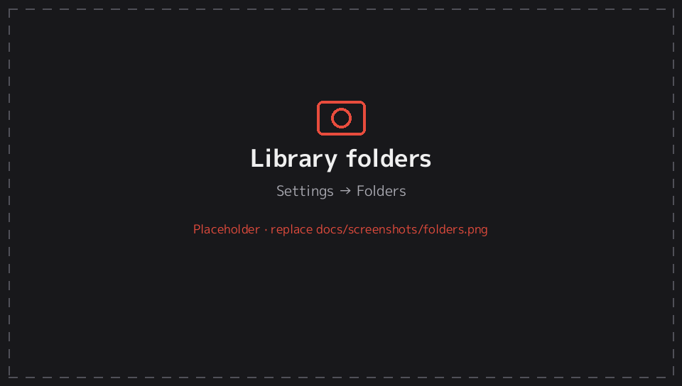

# 1. Getting started

[← Documentation](README.md)

## Requirements

- A PS Vita or PS TV running **HENkaku** or **Ensō** (custom firmware).
- **VitaShell**, to install the app and copy files.

## Installing

1. Download `EnManga-Beta-v1.0.vpk` from the [Releases](../../../releases) page.
2. Copy it to the Vita. In VitaShell, press SELECT for USB or FTP and copy the file to `ux0:` (any folder).
3. In VitaShell, select the `.vpk` and press ✕/○ to install it, then confirm.
4. Start **EnManga** from the LiveArea.

EnManga's Title ID is `ENMG00001`, so it installs alongside NOBORU without replacing it. Installing a newer version over an older one keeps your library, reading progress and settings.

## Where to put your manga

When it starts, EnManga scans these folders. A folder that doesn't exist is skipped.

| Folder | Notes |
|---|---|
| `ux0:data/enmanga/import` | Created automatically on first start |
| `ux0:manga` | |
| `uma0:manga` | For a USB or SD2Vita card mounted as `uma0:` |

You can add or remove folders under **Settings → Library → Folders** (see [Library folders](#library-folders)).

After copying new manga, the library rescans at the next start. To rescan straight away, press **△ → Rescan library** in the Library tab, or use **Settings → Rescan now**.

## Supported files

| Type | Supported |
|---|---|
| Folders of images | ✅ |
| `.cbz` and `.zip` archives | ✅ |
| JPG / JPEG, PNG, BMP, GIF pages | ✅ |
| **WebP** pages | ❌ The Vita runtime can't decode WebP. Convert them with the [EnManga Converter](converter.md). |
| AVIF, JPEG XL | ❌ Convert them with the EnManga Converter |
| `.cbr` / `.rar`, `.cb7` / `.7z`, PDF, EPUB | ❌ |

A WebP page in an archive shows a message on that page instead of crashing. Japanese file names work, including Shift-JIS names inside zips made on Japanese Windows.

## Folder layouts

EnManga understands the usual ways manga collections are organised, so you shouldn't need to rename or move anything.

```
ux0:manga/
├── Berserk/                          a series folder
│   ├── cover.jpg                     optional series cover
│   ├── Volume 01.cbz                 one archive per volume or chapter
│   └── Volume 02.cbz
├── Blame!/
│   ├── Chapter 01/                   folders of images also work
│   │   ├── 001.jpg
│   │   └── 002.jpg
│   └── Chapter 02/
├── Bleach/
│   ├── Bleach Vol 01/                volume folders inside a series
│   │   ├── Ch 001.cbz
│   │   └── Ch 002.cbz
│   └── Bleach Vol 02/
├── Vagabond v01.cbz                  loose volumes, grouped into one
├── Vagabond v02.cbz                  "Vagabond" series by name
├── Akira.cbz                         a single book is its own series
├── Comics/                           a shelf: each sub-folder is a series
│   ├── Batman/
│   └── Saga/
└── Oneshot/                          a folder of images is a
    ├── 01.jpg                        one-chapter series
    └── 02.jpg
```

### How a series is detected

- **Series folder:** a folder that contains chapters (archives or image folders) is one series.
- **Volume folders:** inside a series, one extra level of folders (`Bleach/Bleach Vol 01/…`) is read as volumes holding chapters.
- **Loose volumes:** archives sitting directly in a library folder are grouped by the name before the volume number. Recognised forms include `v01`, `Vol. 3`, `Volume 2`, `#5`, `第1巻`, and a plain trailing number like `001`. `Naruto Vol. 1.cbz` and `Naruto Vol. 2.cbz` become one **Naruto** series.
- **Shelf folders:** a folder that holds only other series folders (e.g. `Comics/`) isn't a series. Each sub-folder becomes its own series.
- **Single books:** a lone archive, or a folder of images with no sub-folders, is a one-chapter series.

Chapters and volumes sort naturally, so `Ch 2` comes before `Ch 10`.

## Short names

Scanlation and digital releases often have long file names. With **Settings → Short names** on (the default), EnManga shows a cleaned-up name:

| File or folder name | Shown as |
|---|---|
| `Vagabond, v02 [2002] [Viz].cbz` | **Vol. 2** |
| `Kingdom of the Dead (2019) [Digital]` | **Kingdom of the Dead** |
| `One Piece c012.cbz` | **Ch. 12** |
| `Akira v01 c003.cbz` | **Vol. 1 Ch. 3** |
| `Episode 7.cbz` (webtoons) | **Ep. 7** |
| `第2巻.cbz` | **第2巻** (kept as is) |

The full original name is still shown in the volume preview on the series screen, and search matches both names. Turn Short names off to see original names everywhere.

## Series covers

The library shows one cover per series. EnManga looks for a cover image in the series folder, in this order:

1. `cover.*` or `表紙.*`, in any capitalisation (`Cover.JPG`, `COVER.jpeg`)
2. `folder.*`, `poster.*`
3. Names starting with "cover": `cover_front.jpg`, `Cover (1).jpg`, `front cover.jpg`
4. An image named after the series: `Vagabond.jpg`, `Vagabond Cover.png`. For loose volumes such as `Naruto Vol. 1.cbz`, put `Naruto.jpg` next to them.
5. `thumb.*`

Accepted cover formats are JPG, JPEG, PNG, BMP and GIF; `cover.webp` is skipped. If there's no cover image, EnManga uses the first volume's own cover (a `cover.jpg` inside its folder), or else its first page.

Cover images are never shown as a page, chapter or volume, and a folder containing only a cover image isn't treated as a series. A new cover image appears after the next rescan.

## Animated GIF covers

A series cover can be an **animated GIF**: name it `cover.gif` and put it in the series folder. The same works for a volume folder's own `cover.gif`. To make one from a still image, use the [Cover Animator](cover-animator.md).

| Setting (Settings → *Animated GIF covers*, or △ in the library) | Behaviour |
|---|---|
| **When selected** (default) | The cover you're on plays its animation: in the library, in the volume grid and on the series screen. The others show the first frame. |
| **Always** | Every visible GIF cover plays |
| **Off** | First frame only |

The first frame appears straight away, like any other cover, and the animation starts once it has loaded, usually after a moment.

Each animation frame is kept in memory at full size, so EnManga is careful with them:
- **Size limit:** a GIF whose frames would take more than about 32 MB stays a still image. That's roughly 30 frames at 400×600, or 60 frames at 300×430. Keep cover GIFs small, around 300×430 px.
- **Total limit:** all playing animations together are limited to 48 MB, and animations you've moved away from are dropped after a few seconds.
- **While reading:** every animation is stopped when you open the reader, to leave the memory for pages.
- **Limits:** only plain `cover.gif` files animate, not GIFs inside `.cbz` archives. At most 128 frames are played.

## Library folders

**Settings → Library → Folders** opens the folder list:

- Each folder shows *missing* if it doesn't exist (for example, `uma0:` with no card inserted).
- **Add folder…** opens a folder browser. Move with ↑/↓, open a folder with ○/→, go up with ←, and press △ or START to choose the current folder.
- Select a folder to remove it (you'll be asked to confirm).
- Adding a folder rescans the library.
- **Rescan now** scans again straight away.



---
Next: [2. Library →](library.md)
