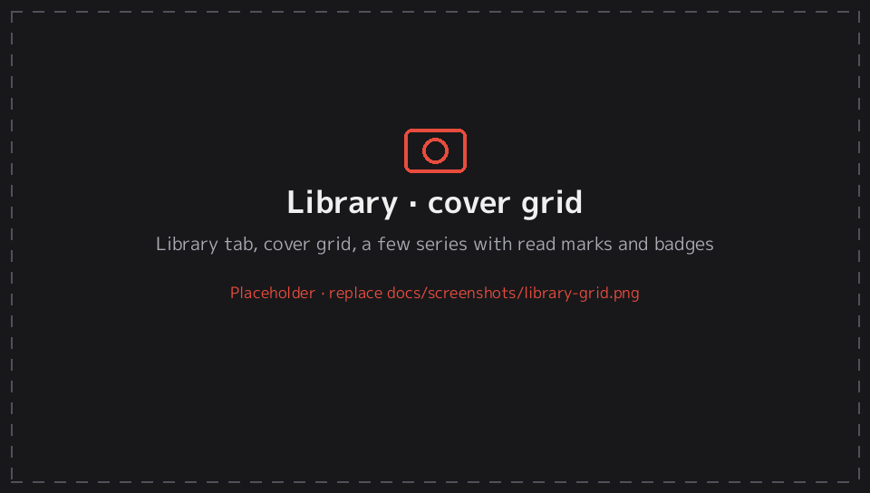
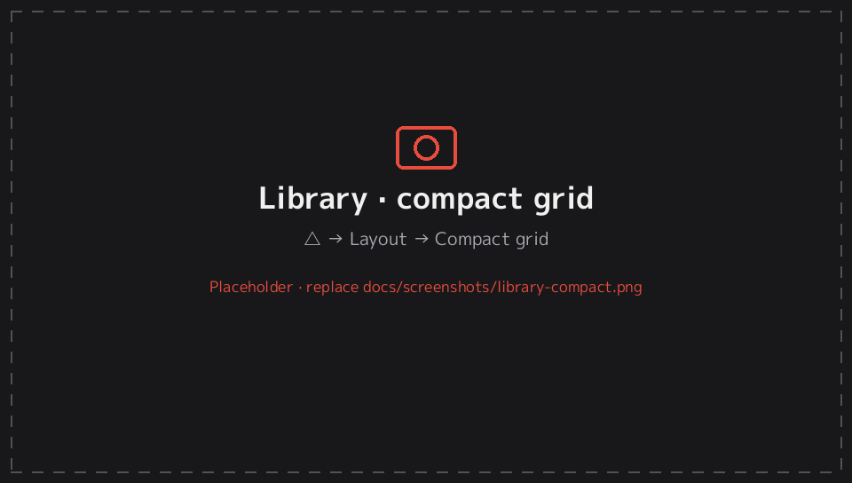
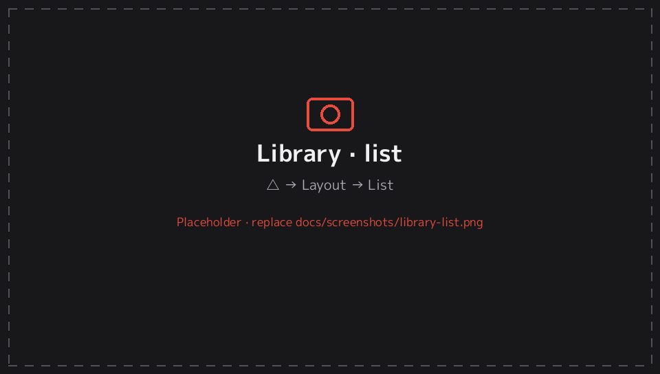
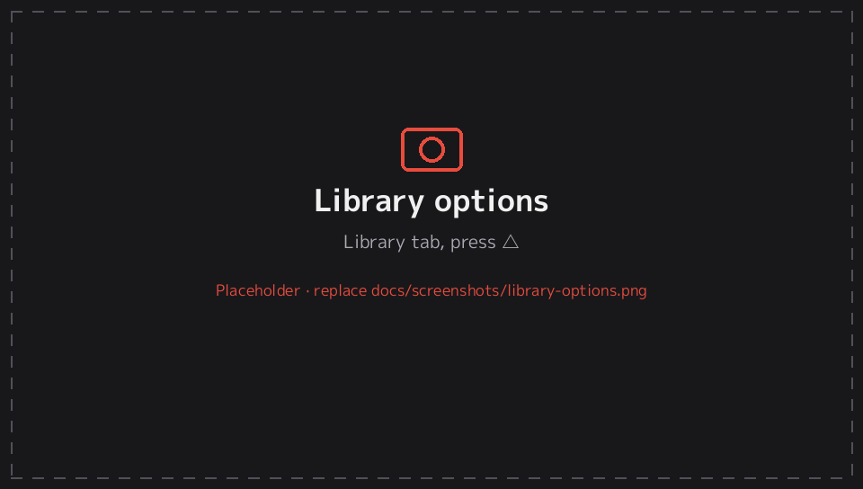
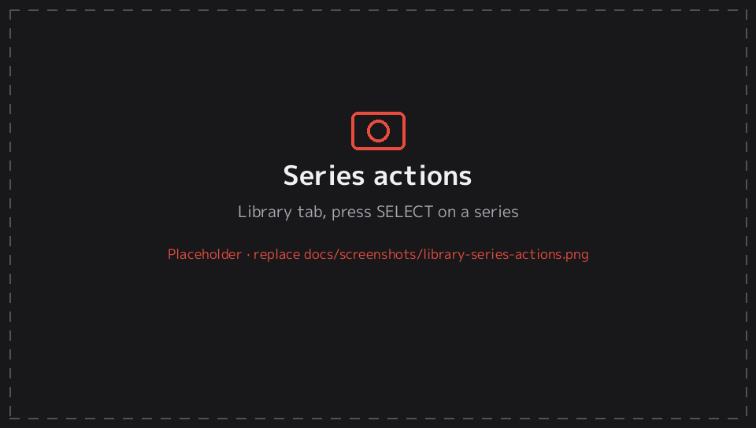
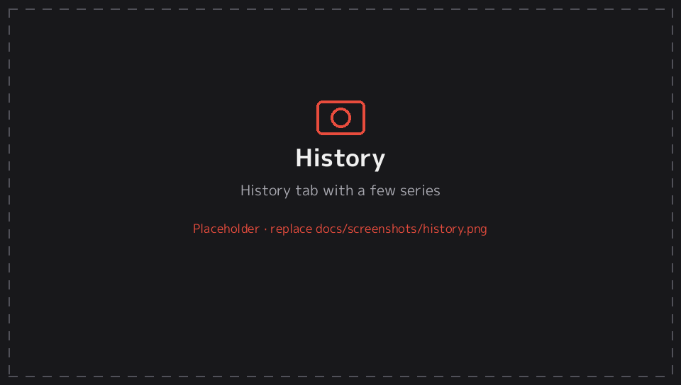

# 2. Library

[← Documentation](README.md)

The home screen has three tabs: **Library**, **History** and **Settings**. In landscape they sit in a rail on the left; press ← at the left edge to move to the rail. In portrait they're a bar along the bottom; press ↓ from the last row. Tapping a tab icon also works.

## Library tab

Each series appears once, with its cover. On the covers you'll see:

| Mark | Meaning |
|---|---|
| Number badge (top left, in the accent colour) | Number of unread volumes or chapters (Settings → *Unread badges*) |
| ✓ and a dimmed cover | Every volume has been read |
| Thin accent-coloured bar along the bottom | Reading in progress (share of volumes read) |

Under each cover is the series title, on two lines, one line or hidden (*Titles under covers*).

### Opening a series

- **○ / ✕** (whichever is your confirm button) opens the [series screen](series.md), where the **Continue** button is already selected. Pressing confirm twice takes you back to your last page.
- **START** skips the series screen and resumes reading straight away.
- With **Settings → Opening a series → Continue reading**, confirm resumes reading directly too. This only applies once you've started the series; otherwise the series screen opens.

### Layouts

Press **△** for the Library options, then **Layout**:

| Layout | Description |
|---|---|
| **Cover grid** | Covers with titles underneath. 3–9 columns (*Columns*, default 6). |
| **Compact grid** | Smaller covers with the title printed on the cover, so more fit on screen. |
| **List** | One row per series: small cover, title, volume count, unread count, the date you last read it, and a progress bar. |

### Library options (△)

| Section | Option | Choices |
|---|---|---|
| Display | Layout | Cover grid · Compact grid · List |
| | Columns | 3–9 |
| | Titles under covers | Two lines · One line · Hidden |
| | Unread badges | On / off |
| | Animated GIF covers | Off · When selected · Always ([details](getting-started.md#animated-gif-covers)) |
| Sort & filter | Sort by | Title · Last read · Date added · Unread · Chapters |
| | Reverse order | On / off |
| | Show | All · Unread · In progress · Completed · Bookmarked |
| Library | Search… | Opens the keyboard |
| | Categories… | Manage categories |
| | Folders… | [Library folders](getting-started.md#library-folders) |
| | Rescan library | Scan the folders again now |

**Show** filters:
- *Unread*: nothing read yet.
- *In progress*: started but not finished.
- *Completed*: everything read.
- *Bookmarked*: has a bookmarked chapter or page.

The active filter and search are shown in the accent colour at the top right, with the number of matching series.

### Search

Press **□** (or △ → *Search…*) and type part of a title. Search matches both the short title and the original folder or file name, and Japanese works. Press **✕/○ (back)** in the library to clear the search.

### Categories

Categories are your own shelves, such as *Reading*, *Seinen* or *To read*. A series can be in several.

- **Create:** press SELECT on a series → *Categories…* → *New category…*, or △ → *Categories…* → *Add category…*.
- **Assign:** SELECT on a series → *Categories…*, then tick or untick each category.
- **Switch:** press **L / R** in the library, or tap a category name at the top. *All* shows everything.
- **Manage:** △ → *Categories…* (or Settings → Library → Categories) lets you rename, move up or down, or delete a category. Deleting a category doesn't remove any manga.

### Series actions (SELECT)

| Action | What it does |
|---|---|
| Continue / Start reading | Resume (or start) reading |
| Open details | Open the series screen |
| Categories… | Tick the categories this series belongs to |
| Mark all as read / unread | For every volume in the series |
| Reader settings for this series… | Reading options that apply only to this series (see [Presets](presets.md)) |
| Remove from history | Remove it from the History tab without losing progress |

### Touch

Tap a cover to open it. Drag up and down to scroll; the list keeps gliding briefly after you let go.

## History tab

The series you've read, newest first, with the volume or chapter, the page you were on and when you read it.

| Button | Action |
|---|---|
| ○ / ✕ (confirm) or START | Resume at that page |
| SELECT | Open the series screen |
| □ | Remove this entry |
| △ | Clear all history (asks first) |

Removing history doesn't reset your reading progress or read marks.

## Status area

The top-right corner shows the time and battery. A **lock icon** there means the screen orientation is locked. Tap the corner to switch between locked and auto-rotate (see [Portrait mode](orientation.md)).

---
[← 1. Getting started](getting-started.md) · Next: [3. Series screen →](series.md)
