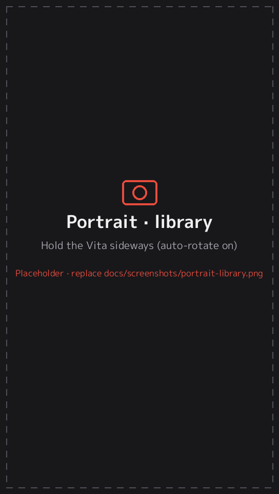
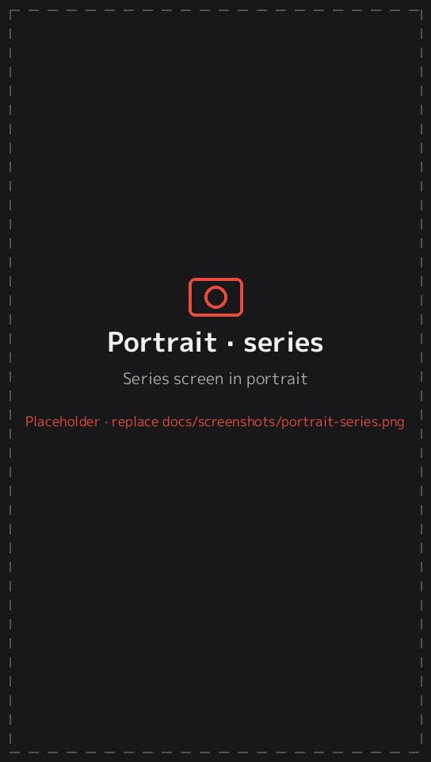
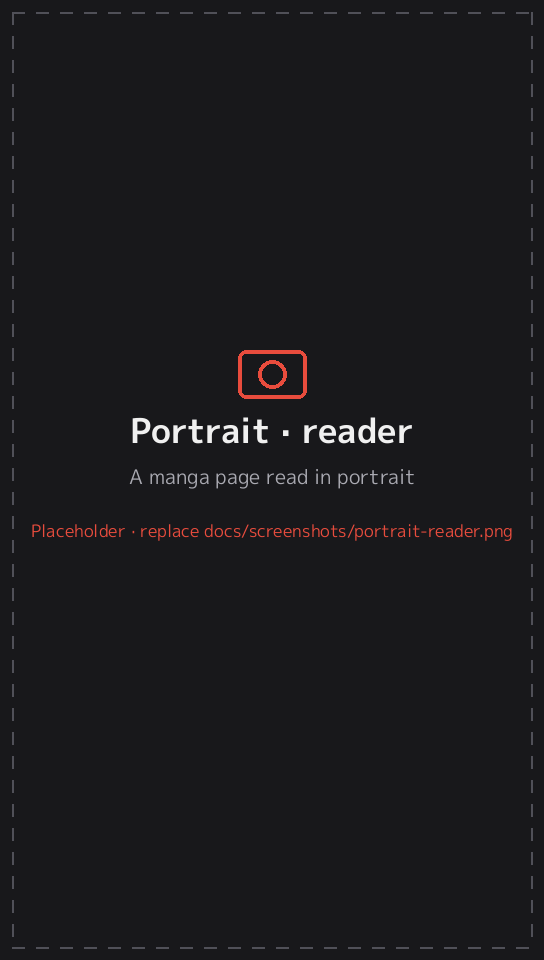
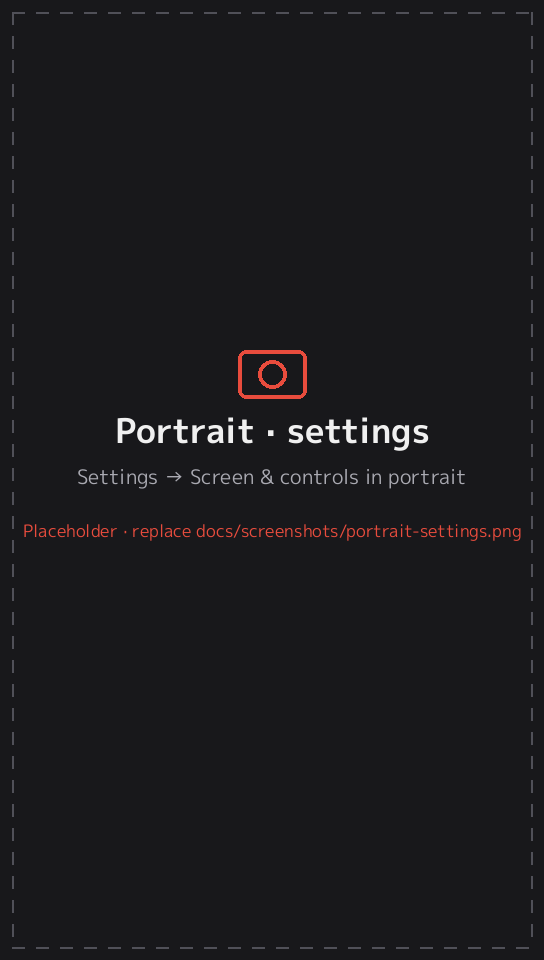
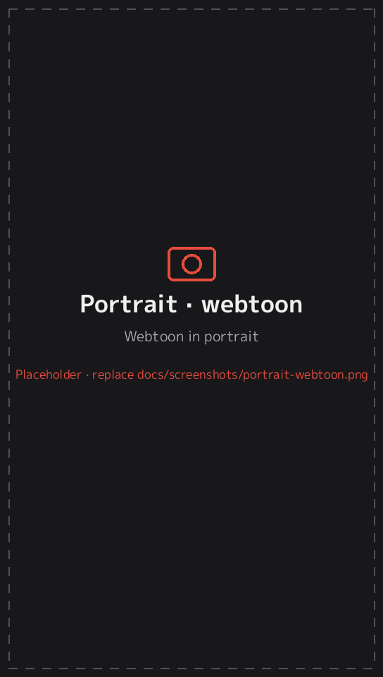

# 6. Portrait mode, auto-rotate and rear touchpad

[← Documentation](README.md)

## Portrait mode

EnManga works with the Vita held upright, like a book, in either direction:

| Orientation | How you hold the Vita |
|---|---|
| **Landscape** | Normally |
| **Portrait · D-pad down** | Turned so the D-pad side is at the bottom |
| **Portrait · D-pad up** | Turned so the D-pad side is at the top |

Everything rotates: the library, series screen, settings, menus and the reader. The D-pad and sticks are remapped, so ↑ always means "up on the screen" however you hold the Vita.

In portrait, some layouts change:
- **Library:** the tabs move to a bar along the bottom, there are fewer columns, and the categories go on a second header line.
- **Series screen:** the cover and info sit at the top, with the volumes underneath (3 per row, or 4 in compact).
- **Reader menu:** the button hints in the top bar are hidden to make room, and the page slider fits the narrow screen.

| Portrait library | Portrait series | Portrait reader |
|---|---|---|
|  |  |  |

> The Vita can only draw text upright, so portrait text is drawn from glyph sheets built into the app (Latin and Japanese, about 6,000 characters). Characters outside that set show as □ (or ? for non-Asian scripts). The on-screen **keyboard** (search, names) is drawn by the system and always opens in landscape.

## Choosing the orientation

**Settings → Screen & controls → Screen orientation**:

| Choice | Behaviour |
|---|---|
| **Auto-rotate** | Follows how you hold the Vita, using its motion sensor |
| **Landscape** | Always landscape (default) |
| **Portrait · D-pad down** | Always this portrait direction |
| **Portrait · D-pad up** | Always this portrait direction |

### Auto-rotate

- Turn the Vita and the screen follows after about half a second, so a brief tilt doesn't flip it.
- Lying the Vita flat (on a table, or in bed) keeps the current orientation.
- Upside-down landscape counts as landscape.
- The motion sensor is only switched on while auto-rotate is in use.

### Rotation lock

Tap the **status area** (the clock and battery at the top right) in the library or series screen, or the **🔒 icon** in the reader menu:

- With auto-rotate on, this **locks the current orientation**. A lock icon appears next to the clock and a message says *Rotation locked*.
- When locked, it turns **auto-rotate back on**.

### Remembered

EnManga remembers the last orientation, or your lock, and starts that way next time.

## Reader orientation

Each series also has its own **Orientation** setting (Reader settings → *Orientation*, the quick button in the reader menu, or **SELECT** while reading):

| Choice | Behaviour |
|---|---|
| **Same as app** (default) | The reader follows the app: auto-rotate, or whatever you've locked |
| **Landscape** | This series always opens in landscape |
| **Portrait · D-pad down / up** | This series always opens in that portrait direction |

For example, set webtoons to *Portrait* and leave manga on *Same as app*. When you leave the reader, the app goes back to its own orientation.

The *Manga · portrait*, *Comic · portrait* and *Webtoon* [presets](presets.md) use portrait. The others use *Same as app*.

## Rear touchpad

While reading, the touchpad on the back of the Vita works as a page-turner:

| Gesture | Paged modes | Webtoon / long strip |
|---|---|---|
| **Tap** | Next page | Scroll on by one step |
| **Drag** | On a zoomed page: pan. Otherwise: swipe to turn the page. | Scroll, with momentum |

At the end of a chapter, a tap opens the next chapter.

**Which part of the pad responds:**

| Orientation | Active area |
|---|---|
| Landscape | The whole pad |
| Portrait · D-pad up | The half behind the **L** button, which is the top half as you hold it |
| Portrait · D-pad down | The half behind the **R** button, which is the top half as you hold it |

In portrait, your hand rests on the bottom half of the back, so only the top half responds. That avoids accidental page turns.

The rear touchpad only works in the reader. You can switch it off with **Settings → Screen & controls → Rear touchpad**.

## If something is the wrong way round

These two settings exist because the Vita's sensors could behave differently on some consoles:

| Setting | Turn it on if… |
|---|---|
| **Flip portrait direction (auto-rotate)** | Auto-rotate shows portrait upside down |
| **Rear touchpad is mirrored** | The wrong half of the rear pad responds in portrait |

Both are off by default, and on a normal Vita they should stay off.

---
[← 5. Reader presets](presets.md) · Next: [7. Controls →](controls.md)
