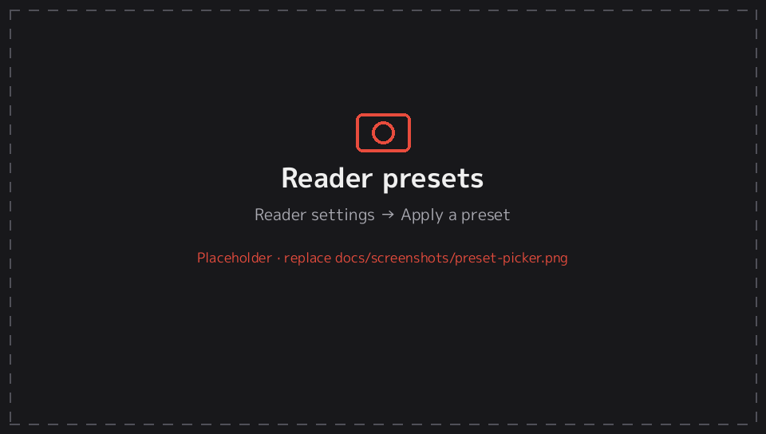
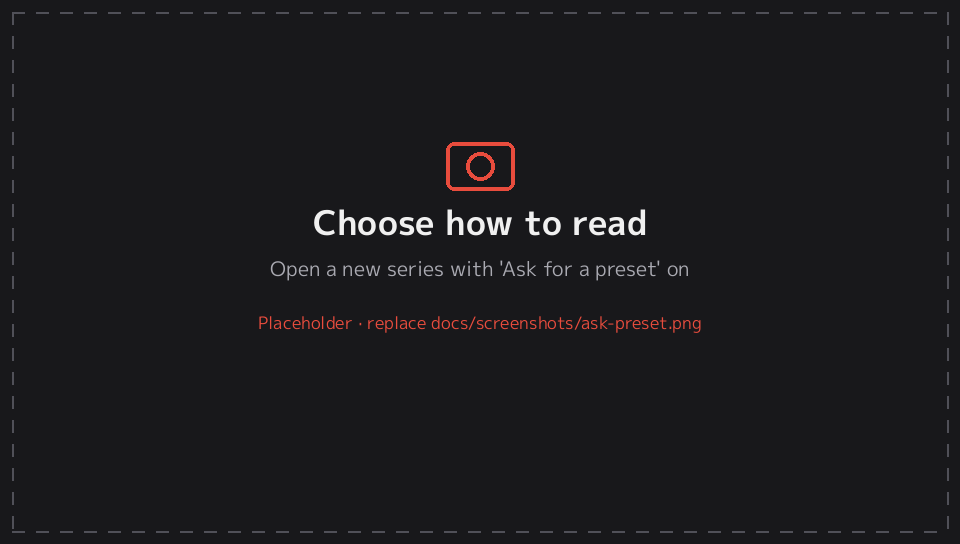

# 5. Reader presets

[← Documentation](README.md)

## Defaults and per-series settings

Reader options work on two levels:

1. **Defaults:** the settings used by every series you haven't customised. Change them in **Settings → Reader defaults**.
2. **Per-series settings:** when you change an option marked **(series)** while reading, it's saved for that series only. Your manga can stay right to left and fit to screen while your comics are left to right and fit to width.

The **(series)** options are:
- Reading mode, scale type and zoom start position.
- Two-page spreads, show first page alone, wide pages, crop borders and trim margins.
- Orientation and webtoon width.
- Background, page tone, colour filter and filter strength.
- Tap zones, invert tap zones, invert page buttons and the page indicator.

The others (brightness, animation, preload, quality and so on) are always global.

In the reader's settings sheet (START), the options are grouped under **This series** and **All series**, so you can see which is which. *Reset this series to defaults* removes the series' own settings.

The series screen shows **Custom reader settings** under the title when a series has its own settings.

## Presets

A preset is a saved set of the **(series)** options. You can apply one to a series in a single step, or make it your default.

### Built-in presets

| Preset | Reading mode | Scale | Orientation | Other |
|---|---|---|---|---|
| **Manga** | Right to left | Fit screen | Same as app | Single pages, wide pages fit |
| **Manga · two pages** | Right to left | Fit screen | Same as app | Two-page spreads, first page alone |
| **Manga · portrait** | Right to left | Fit screen | Portrait | Wide pages rotated to fit |
| **Comic** | Left to right | Fit screen | Same as app | Single pages |
| **Comic · portrait** | Left to right | Fit screen | Portrait | Wide pages rotated to fit |
| **Comic · fit width** | Left to right | Fit width | Same as app | Zoom start: auto |
| **Webtoon** | Webtoon | Fit width | Portrait | Full width |
| **Webtoon · landscape** | Webtoon | Fit width | Landscape | 60% width |

A preset only sets the options it lists. Everything else keeps your defaults.

### Applying a preset

| Where | How |
|---|---|
| While reading | START → **Apply a preset** (applies to this series) |
| Series screen | △ → **Reader preset…** (applies without opening the series) |
| Library | SELECT → *Reader settings for this series…* (change single options) |
| As the default for all series | Settings → **Reader presets…** → choose a preset → **Use as default for all series** |

A preset's name is shown with a ✓ while its settings are in use. If you change something afterwards, it shows *Custom*.

### Your own presets

- **From the reader:** set things up the way you like, then START → **Save these settings as a preset…** and type a name.
- **From your defaults:** Settings → Reader presets → **Save current defaults as a preset…**.
- **Make the current series' settings everyone's default:** START → **Make these the default for all series**.

Under **Settings → Reader presets…**, each of your own presets (listed under *Yours*) has these actions:
- *Use as default for all series*.
- *Replace with current defaults*: overwrites the preset with your current defaults.
- *Rename…* (a preset can't take a built-in preset's name).
- *Delete*.

## Choosing how to read on first open

Turn on **Settings → Reader defaults → Ask for a preset when opening a new series**. The first time you open a series, EnManga asks which preset to use (for example *Comic · portrait* for an American comic). Your choice is saved for that series. **Use my defaults** leaves the series on your defaults. You're asked only once per series.

---
[← 4. Reader](reader.md) · Next: [6. Portrait mode →](orientation.md)
