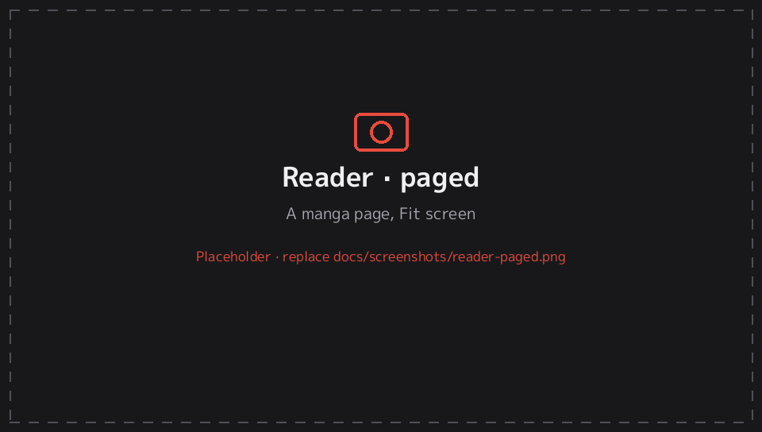
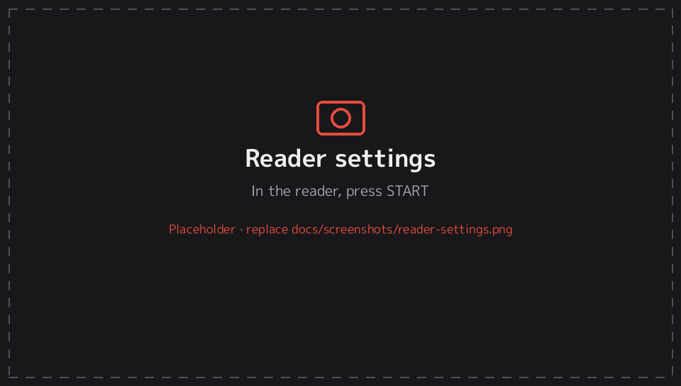
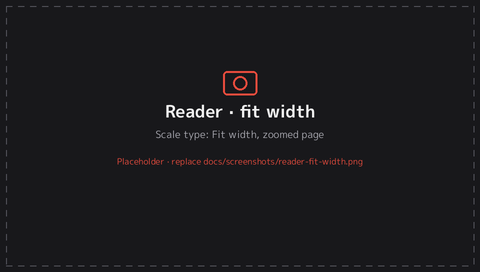
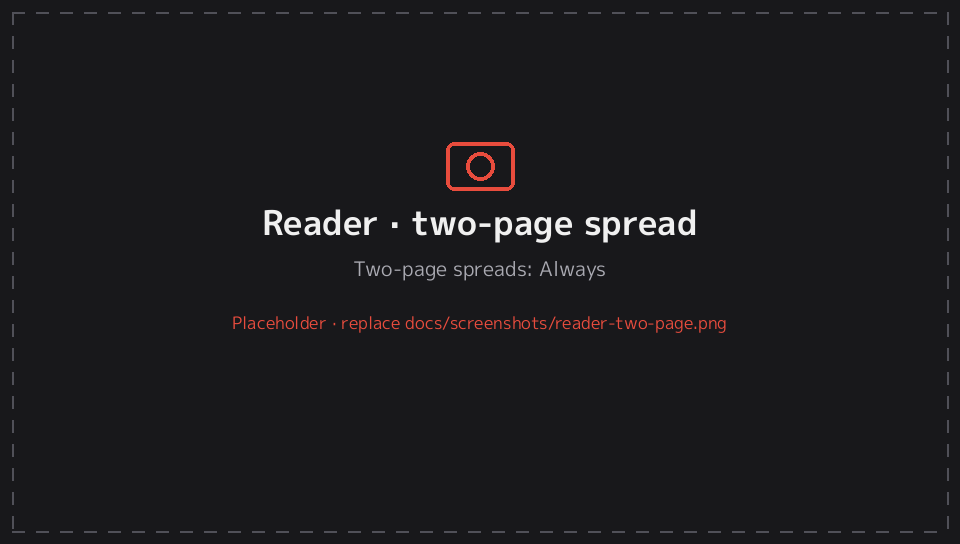
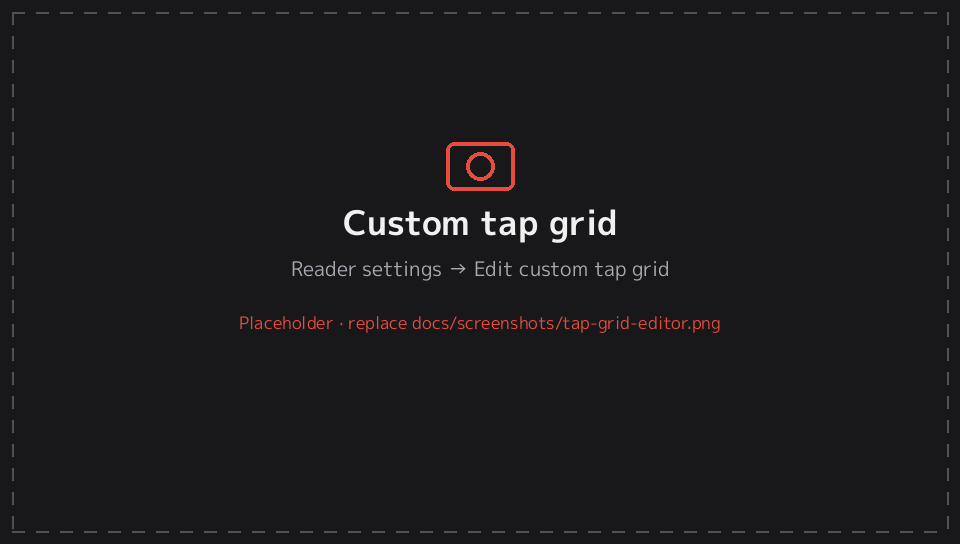
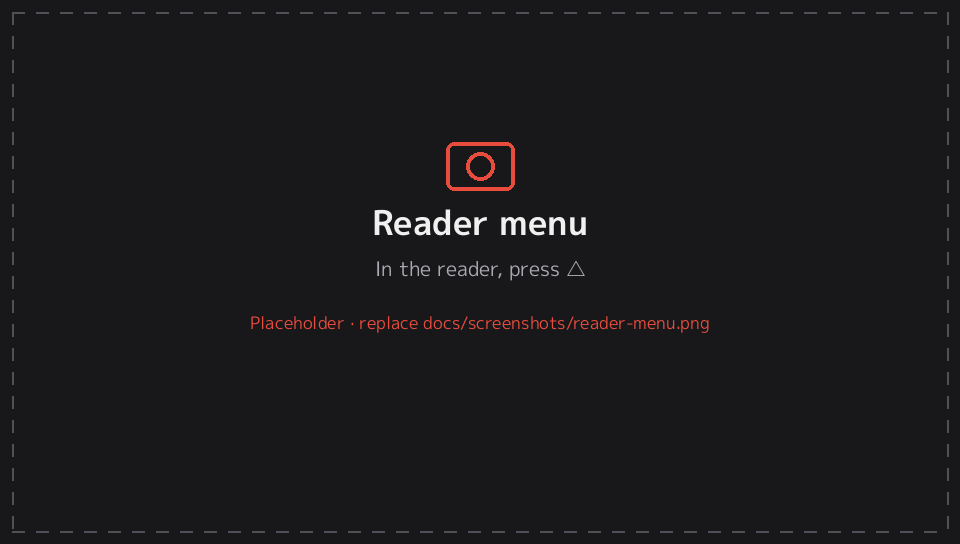
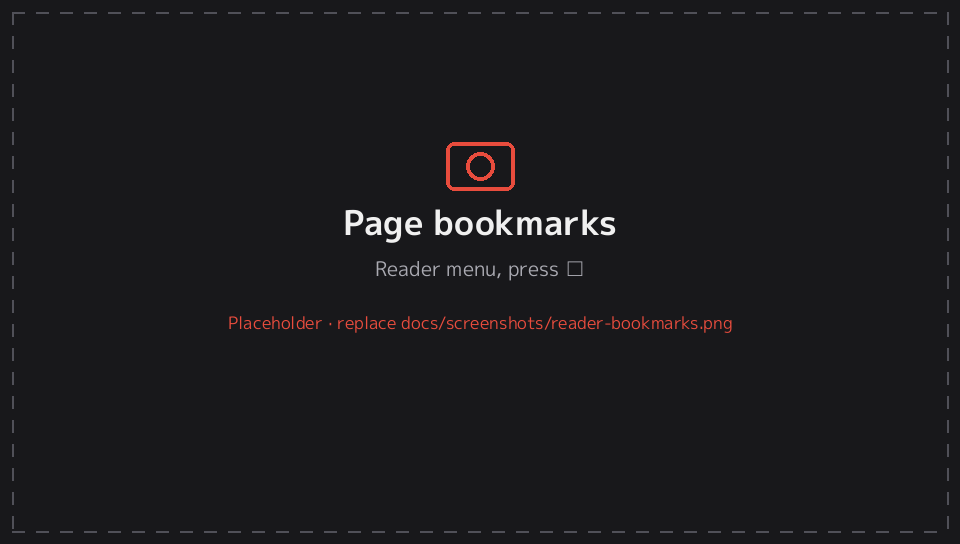
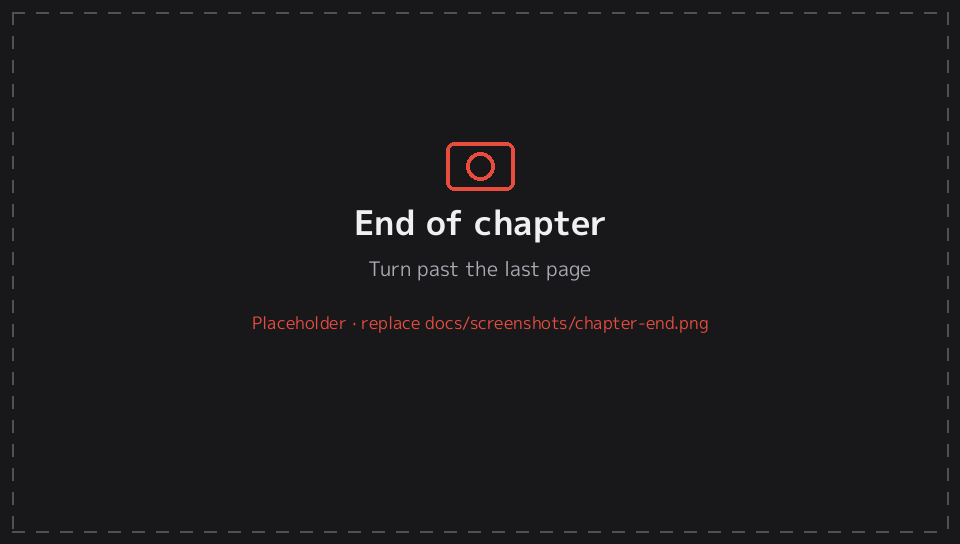
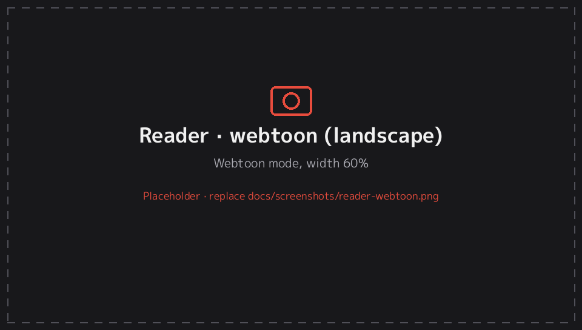

# 4. Reader

[← Documentation](README.md)

Every reader option is under **START** (Reader settings) while reading. Options marked **(series)** are saved separately for each series. The rest apply to all series. See [Presets](presets.md) for how per-series settings and defaults work.

---

## Reading modes

**Reading mode (series)**:

| Mode | How pages move | Typical use |
|---|---|---|
| **Right to left** | One page at a time; the next page is to the left | Japanese manga (default) |
| **Left to right** | One page at a time; the next page is to the right | Western comics, manhua |
| **Vertical** | One page at a time; the next page is below | Comics read top to bottom |
| **Webtoon** | One continuous scroll, pages joined with no gap | Webtoons, manhwa |
| **Long strip** | One continuous scroll, with a small gap between pages | Long-strip comics |

In the paged modes (the first three), ←/→ and swipes follow the reading direction automatically. For example, in Right to left, → goes back a page.

---

## Fitting and scaling (paged modes)

**Scale type (series)**:

| Scale type | Result |
|---|---|
| **Fit screen** | The whole page is visible (default) |
| **Fit width** | Page fills the screen width; scroll down through it |
| **Fit height** | Page fills the screen height; wide pages can be panned sideways |
| **Smart fit** | Fills the width, as long as the page is no taller than two screens; otherwise it's limited to two screens' height. Good for tall pages in landscape. |
| **Original** | 1 image pixel = 1 screen pixel |
| **Stretch** | Fills the screen exactly, ignoring the aspect ratio |

**Zoom start position (series):** where a page that's bigger than the screen (because of the scale type or zoom) starts. The choices are **Auto** (the top corner you read first: right for Right to left, left for Left to right), **Left**, **Right** or **Center**.

**Scroll zoomed pages before turning** (default on): when a page is larger than the screen, pressing "next" first scrolls through it, by **Scroll step** (25–100% of the screen, default 75%). Only then does it turn the page. **L / R** always turn the page straight away.

**Texture quality:**
- *Full resolution*.
- *High*, at most 2048 px (default).
- *Balanced*, at most 1280 px. This saves memory on very large scans.

Very tall webtoon pages are cut into pieces automatically, so they always load.

---

## Two-page spreads

**Two-page spreads (series)** shows two pages side by side, like an open book:

| Choice | When |
|---|---|
| **Off** | One page at a time (default) |
| **Always** | Always two pages |
| **Auto (landscape)** | Two pages in landscape, one page in portrait |

**Show first page alone** (series, default on) shows the cover by itself, so that the following pages pair up as they do in the printed book. A wide page, which is usually already a two-page spread, is always shown on its own, and so is a page whose partner would be a wide page.

---

## Wide pages

**Wide pages (series)** controls landscape-shaped pages, which are usually a double-page spread scanned as one image:

| Choice | Result |
|---|---|
| **Fit as is** | Shown whole, scaled to fit (default) |
| **Split in two** | Shown as two halves, one after the other, in reading order (right half first for Right to left) |
| **Rotate to fit** | Turned 90° so it fills the screen; rotate the Vita to read it |

---

## Cropping and margins

- **Crop white/black borders (series):** detects plain white or black borders around a page and cuts them off, so the art fills more of the screen.
- **Trim margins (series):** cuts a fixed 0–20% off every edge, for scans with dirty or uneven edges.

---

## Zoom and panning

| Action | How |
|---|---|
| Zoom in / out | **Pinch** on the screen, or the **right stick** ↑/↓ |
| Quick zoom | **Double-tap** a spot to zoom ×2 there; double-tap again to return (*Double-tap to zoom*, on by default). Webtoon modes zoom ×1.8. |
| Pan | **Drag** on the screen, the **left stick**, or drag on the [rear touchpad](orientation.md#rear-touchpad) |
| Edge swipe | Dragging past the edge of a zoomed page turns the page |

With **Remember zoom per page** (default on), if you zoom into a page, turn away and come back, the zoom and position are restored.

---

## Appearance

| Option | Choices | Notes |
|---|---|---|
| **Background (series)** | Black · Gray · White · Theme | Colour around the page |
| **Brightness** | 20–100% | Dims the page without changing the Vita's backlight. Also adjustable with the brightness swipe below. |
| **Brightness swipe** | **Right edge** · Left edge · Both edges · Off | Slide a finger up or down along that edge of the screen to change the brightness (see below) |
| **Page tone (series)** | Normal · Sepia · Warm · Cool · Mint | Tints the paper: white becomes the tone colour and black ink stays black |
| **Color filter (series)** | None · Warm · Sepia · Night · Paper | A coloured layer over everything. *Night* is a strong orange that cuts blue light. |
| **Filter strength (series)** | 5–80% | How strong the colour filter is |
| **Page indicator (series)** | Off · Page · Page + clock | The small counter at the bottom of the screen |
| **Page turn animation** | On / off | Slide between pages |

---

### Brightness swipe

While reading, slide a finger **up along the right edge** of the screen to brighten the page, or **down** to dim it, like in a video player. A bar with the percentage appears while you slide, and the new brightness is saved.
- **Follows the rotation:** the edge is the edge as you're holding the Vita, so it's still the right-hand edge in portrait.
- **The strip is narrow:** about a tenth of the screen width. A **tap** there still works as a tap zone, and a **sideways swipe** that starts there still turns the page.
- **Which edge:** right (default), left, both, or off (Reader settings → *Brightness swipe*, or Settings → Reader defaults). In webtoon and strip modes, a vertical drag on that edge changes the brightness instead of scrolling. Scroll anywhere else, or set it to *Off* if you'd rather scroll there.
- **Range:** 20–100%. It dims the page itself; the Vita's own backlight (PS button → quick menu) stays as it is.

## Tap zones

**Tap zones (series)** decides what tapping each area of the screen does:

| Layout | Areas |
|---|---|
| **Left / right edges** (default) | Left 30% and right 30% turn pages (following the reading direction); the middle opens the menu |
| **L-shaped** | Top strip and left edge = previous; bottom strip and right edge = next; centre = menu |
| **Kindle-ish** | Top 15% = menu; left third = previous; the rest = next |
| **Custom grid** | Your own 3×3 grid (below) |
| **Disabled** | Every tap opens the menu |

- **Invert tap zones (series)** swaps previous and next.
- **Invert page buttons (series)** swaps the direction of L/R and the D-pad.

### Custom tap grid

**Reader settings → Edit custom tap grid…** shows the 3×3 grid:
- Move between cells with the D-pad. Press **confirm** or tap a cell to change it (Previous → Next → Menu → Nothing); **□** changes it the other way.
- **△** cycles ready-made layouts: *Left = previous*, *Left = next (manga)*, *Bottom-heavy*, and *Rows: top previous*.
- **Back** or **START** saves and closes.

Choose **Tap zones → Custom grid** to use it.

---

## The reader menu

Open the menu with **△**, **confirm**, or a tap on the menu zone.

**Top bar:** ← back to the series · series and chapter name · 🔒 rotation lock (tap to lock or unlock) · 🔖 bookmark this page · ⚙ reader settings.

**Bottom bar:**
- **‹ Prev / Next ›** go to the previous or next chapter (also **L / R** while the menu is open).
- **The page slider:** drag it, tap a position, or use **← / →** (hold to move faster).
- **Quick buttons:** tap to cycle the **reading mode**, the **scale type** (paged modes) or **auto-scroll** (webtoon modes), and the **orientation**. Each change is saved for this series.

| Button (menu open) | Action |
|---|---|
| SELECT | Bookmark or unbookmark this page |
| □ | This chapter's bookmarked pages |
| START | Reader settings |
| L / R | Previous / next chapter |
| ← / → | Move the page slider |
| △ / confirm / back | Close the menu |

### Page bookmarks

Bookmark any page from the menu (SELECT, or the 🔖 icon). Bookmarked pages show as ★ on the series screen. They're listed under **△ → Bookmarks…** on the series screen and under **□** in the reader menu, and they count for the library's *Bookmarked* filter.

---

## Chapter transitions

Turning past the last page shows a card with **FINISHED** (the chapter you just read) and **NEXT** (the chapter that follows). Turning back past the first page shows **START OF** and **PREVIOUS** the same way.

- With **Continue into next chapter** on (the default), turning the page again opens the next chapter. With it off, press confirm.
- At the end of the last chapter the card says *You're all caught up*.
- Webtoon and strip modes go on to the next chapter when you scroll past the end.
- Finishing a chapter marks it as read.

---

## Webtoon and long strip

- **Webtoon width (series):** 40–100% of the screen width. Use 60% or so in landscape for comfortable text.
- **Scrolling:** ↑/↓ scroll by the scroll step; ←/→ scroll by almost a full screen. You can also drag with momentum, use the left stick, or drag on the rear touchpad.
- **Auto-scroll:** **□** turns it on or off. **↑/↓** (or ←/→) change the speed, 1–10. Touching the screen pauses it. It carries on into the next chapter, and the starting speed is under *Auto-scroll speed*.
- Zooming (pinch, double-tap or right stick) enlarges the strip, and you can pan sideways with the left stick.

---

## Other reader options

| Option | Default | What it does |
|---|---|---|
| Pages to preload | 2 | How many pages around the current one are loaded in advance (1–4). More means faster page turns but uses more memory. |
| Keep screen on while reading | On | Stops the Vita dimming or sleeping while you read |
| Continue into next chapter | On | See [Chapter transitions](#chapter-transitions) |
| Orientation (series) | Same as app | See [Portrait mode](orientation.md#reader-orientation) |

Reading time is counted only while you're actually reading. It pauses after two minutes without input, and keeps running during auto-scroll. Totals are under Settings → Statistics.

---
[← 3. Series screen](series.md) · Next: [5. Reader presets →](presets.md)
