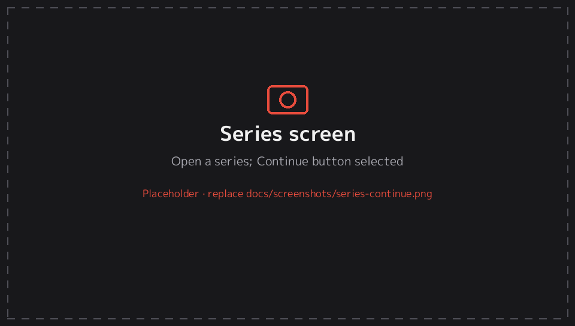
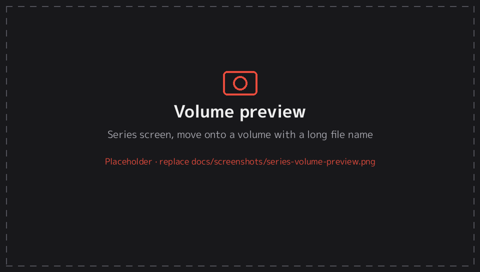
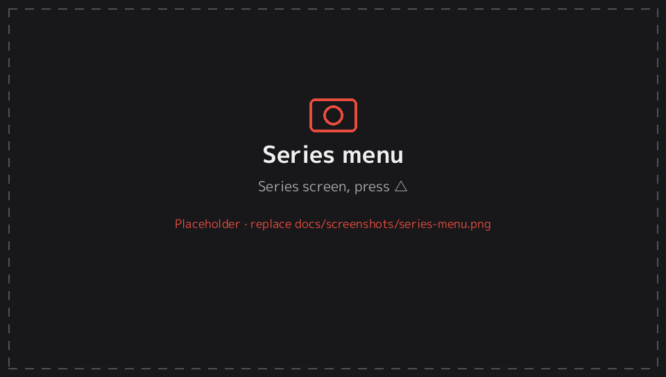
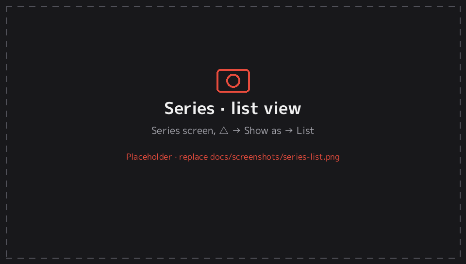
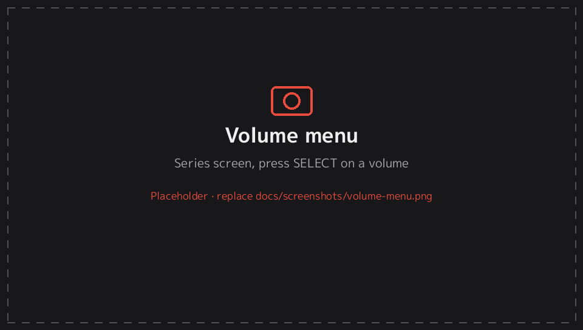

# 3. Series screen

[← Documentation](README.md)

Opening a series from the library shows its volumes or chapters.

## Layout

- **Left side (top in portrait):** the series cover and title, and how many volumes there are and how many are read. It also shows reading time and pages read, plus *Custom reader settings* if this series has its own reader settings.
- **Continue button:** shows the volume and page you'll go back to (e.g. *Vol. 2 · p. 4 / 6*). It reads **Start reading** for a series you haven't started. It's selected when the screen opens, so pressing confirm takes you straight back to your page.
- **Right side (bottom in portrait):** the volumes, in the view you've chosen.

## Volume marks

| Mark | Meaning |
|---|---|
| ✓ (top right) and *Read* under the name | Finished |
| Accent-coloured bar along the bottom and *Page 4 / 6* | In progress |
| **Next** tag | The volume Continue will open |
| ★ under the name | Number of bookmarked pages |

Opening a volume that's in progress resumes at your page. A finished or unread volume starts at page 1.

## Volume preview

When you move onto a volume, the left panel previews it. It shows the volume's cover, its short name (*Vol. 14*), the **full original file name** (e.g. *Vagabond, v14 [2002] [Viz]*), the file type, its status (*Not started* / *Page 4 of 6* / *Read*) and its bookmarks. Move back onto **Continue** (← from the first column) to see the series info again.

## Views, sorting and filters (△)

Press **△** for the series menu. The **View** section changes how this series' volumes are shown:

| Option | Choices |
|---|---|
| Show as | **Cover grid** (5 per row; 3 in portrait) · **Compact grid** (7 per row; 4 in portrait) · **List** |
| Sort by | Number · Last read · Unread first · Progress |
| Reverse order | On / off (newest first) |
| Show | All · Unread · In progress · Read · Bookmarked |
| Use this view for all series | Makes the current view the default and clears per-series views |

These choices are **remembered per series**. The defaults for series you haven't changed are under Settings → *Inside a series*.

The **Series** section of the same menu has:

| Action | What it does |
|---|---|
| Bookmarks… | Every bookmarked chapter and page in the series; select one to open it there |
| Categories… | Tick the categories this series belongs to |
| Reader preset… | Apply a [reading preset](presets.md) to this series without opening it |
| Reader settings for this series… | Change this series' reading options directly |
| Mark all as read / unread | For every volume |
| Remove from history | Remove it from the History tab |
| Reading time, Pages read, Finished, Location | Statistics for this series and its folder path |

## Volume menu (SELECT)

Press **SELECT** on a volume:

| Action | What it does |
|---|---|
| Read from start | Open at page 1 |
| Mark as read / unread | Toggle the read mark (also **□** on the grid) |
| Mark previous chapters as read | Marks every volume before this one as read |
| Bookmark chapter / Remove chapter bookmark | Adds the volume to the *Bookmarked* filter |
| Bookmarked pages | Jump to a bookmarked page in this volume |

## Buttons

| Button | Action |
|---|---|
| D-pad | Move. ← from the first column goes back to Continue. |
| L / R | Jump two rows up or down |
| ○ / ✕ (confirm) | Continue, or open the selected volume |
| □ | Mark the selected volume read or unread |
| SELECT | Volume menu |
| △ | Series menu |
| START | Continue reading |
| ✕ / ○ (back) | Back to the library |

**Touch:** tap a volume to open it, tap Continue to resume, and tap ← (top left) to go back. Drag to scroll.

---
[← 2. Library](library.md) · Next: [4. Reader →](reader.md)
