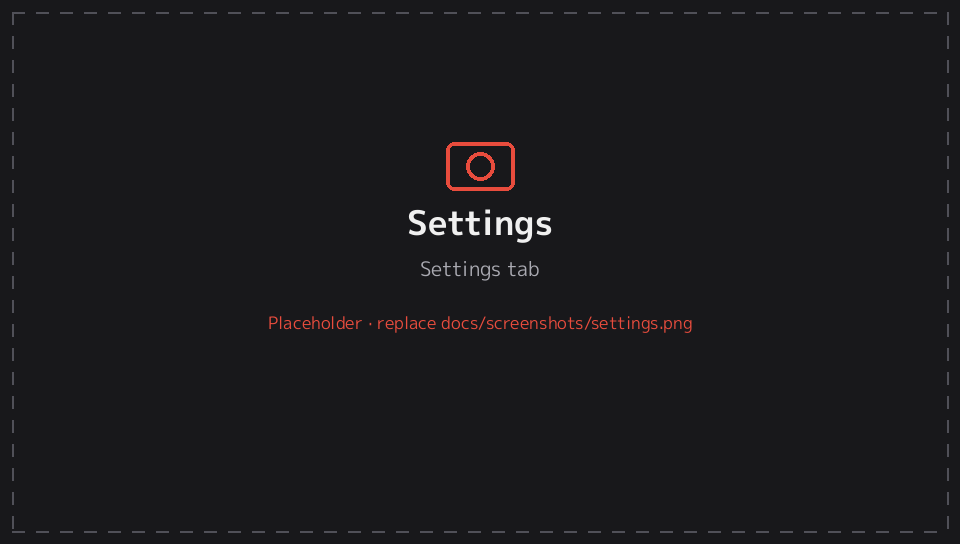
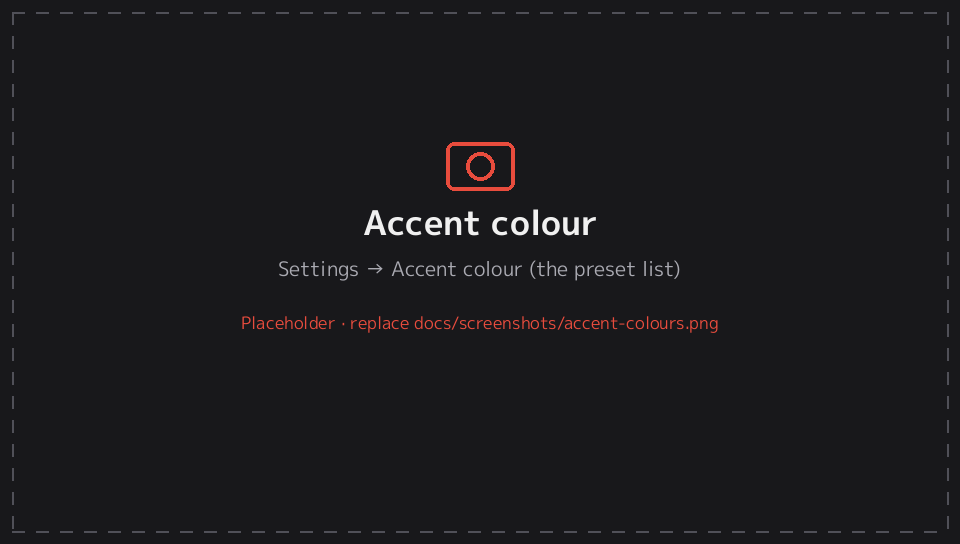
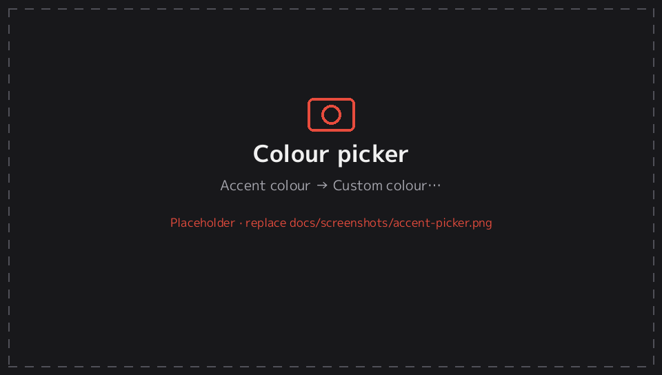
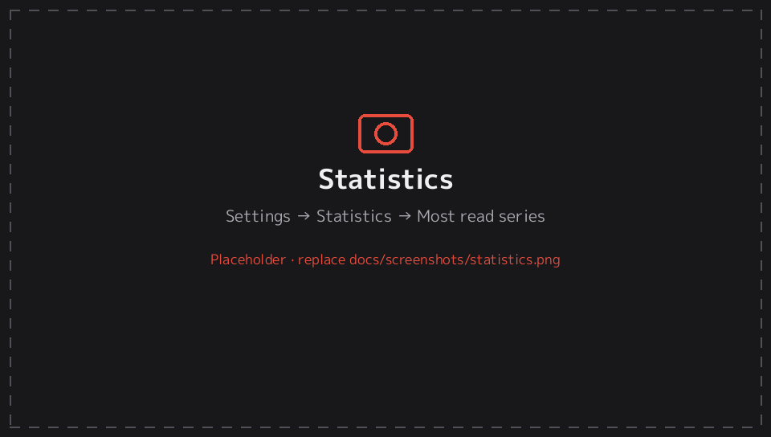

# 8. Settings reference

[← Documentation](README.md)

This page lists every setting in the **Settings** tab, in the order they appear. Defaults are in **bold**. Settings are saved automatically.

## Appearance

| Setting | Options | What it does |
|---|---|---|
| Theme | **Dark** · Black · Light | App colours. *Black* is pure black, good for OLED screens. |
| Accent colour | **Orange** and 11 other presets, or any custom colour | The highlight colour used for buttons, selections, badges, progress bars and switches. See [Accent colour](#accent-colour). |
| Confirm button | **System default** · ✕ confirms · ○ confirms | Which button confirms and which goes back |
| Library layout | **Cover grid** · Compact grid · List | See [Library layouts](library.md#layouts) |
| Grid columns | 3–9 (**6**) | Covers per row in the library grid |
| Unread badges | **On** · Off | Unread counts on covers |
| Opening a series | **Show volumes** · Continue reading | What confirm does on a series in the library |
| Titles under covers | **Two lines** · One line · Hidden | |
| Animated GIF covers | Off · **When selected** · Always | Plays `cover.gif` animations. See [Animated covers](getting-started.md#animated-gif-covers). |
| Short names (Vol. 2 instead of file name) | **On** · Off | See [Short names](getting-started.md#short-names) |

## Accent colour

**Settings → Appearance → Accent colour** sets the highlight colour used across the app: buttons, the selection frame, unread badges, progress bars, switches, the *Next* tag and section titles. The rest of the theme (Dark, Black or Light) stays the same.

**Presets:** Orange (default, matching the logo), Classic red (the colour of earlier test builds), Amber, Lime, Green, Teal, Sky, Blue, Indigo, Purple, Pink and Silver. Pick one and it applies straight away.

**Custom colour…** opens the colour picker:

| Control | Action |
|---|---|
| D-pad / left stick | Move in the square: ←/→ for how vivid the colour is, ↑/↓ for how bright (hold to move faster) |
| L / R, right stick | Change the hue |
| Touch | Drag in the square or along the hue bar |
| □ | Type a hex code, e.g. `F06E28` |
| △ | Back to the colour you started with |
| Confirm / START / *Save* | Save |
| Back / ← | Cancel and keep the old colour |

While you pick, the whole app previews the colour. The right side (below, in portrait) shows a sample *Continue* button, badge, switch and progress bar. Text on buttons switches between white and dark automatically, so it stays readable on light colours like Silver or yellow.

## Screen & controls

| Setting | Options | What it does |
|---|---|---|
| Screen orientation | Auto-rotate · **Landscape** · Portrait · D-pad down · Portrait · D-pad up | See [Portrait mode](orientation.md) |
| Flip portrait direction (auto-rotate) | On · **Off** | Only if auto-rotate picks the wrong portrait direction |
| Rear touchpad (tap = next page, drag = scroll) | **On** · Off | See [Rear touchpad](orientation.md#rear-touchpad) |
| Rear touchpad is mirrored | On · **Off** | Only if the wrong half of the pad responds |

## Inside a series

Defaults for the volume screen. Each series can override these with △ (see [Series screen](series.md#views-sorting-and-filters-)).

| Setting | Options |
|---|---|
| Default view | **Cover grid** · Compact grid · List |
| Default sort | **Number** · Last read · Unread first · Progress |
| Newest first | On · **Off** |

## Library

| Setting | What it does |
|---|---|
| Folders | Which folders are scanned. See [Library folders](getting-started.md#library-folders). |
| Categories | Rename, reorder or delete categories |
| Rescan on startup | **On**: look for new or removed manga every time EnManga starts |
| Rescan now | Scan straight away |

## Reader defaults

These are the defaults for all series. Options marked **(series)** can also be set for each series separately (see [Presets](presets.md)). All of them are explained in the [Reader](reader.md) guide.

| Setting | Options (default in bold) |
|---|---|
| Reader presets… | Manage presets and set the default ([Presets](presets.md)) |
| Ask for a preset when opening a new series | On · **Off** |
| Reading mode (series) | **Right to left** · Left to right · Vertical · Webtoon · Long strip |
| Scale type (series) | **Fit screen** · Fit width · Fit height · Smart fit · Original · Stretch |
| Zoom start position (series) | **Auto** · Left · Right · Center |
| Two-page spreads (series) | **Off** · Always · Auto (landscape) |
| Show first page alone (series) | **On** · Off |
| Wide pages (series) | **Fit as is** · Split in two · Rotate to fit |
| Crop white/black borders (series) | On · **Off** |
| Trim margins (series) | **0** – 20% |
| Orientation (series) | **Same as app** · Landscape · Portrait · D-pad down · Portrait · D-pad up |
| Webtoon width (series) | 40 – **100**% |
| Background (series) | **Black** · Gray · White · Theme |
| Brightness | 20 – **100**% |
| Brightness swipe (screen edge) | **Right edge** · Left edge · Both edges · Off |
| Page tone (series) | **Normal** · Sepia · Warm · Cool · Mint |
| Color filter (series) | **None** · Warm · Sepia · Night · Paper |
| Filter strength (series) | 5 – 80% (**30**) |
| Tap zones (series) | **Left / right edges** · L-shaped · Kindle-ish · Custom grid · Disabled |
| Edit custom tap grid… | Opens the [3×3 editor](reader.md#custom-tap-grid) |
| Invert tap zones (series) | On · **Off** |
| Invert page buttons (series) | On · **Off** |
| Scroll zoomed pages before turning | **On** · Off |
| Scroll step | 25 – 100% (**75**) |
| Page turn animation | **On** · Off |
| Double-tap to zoom | **On** · Off |
| Remember zoom per page | **On** · Off |
| Auto-scroll speed (webtoon) | 1 – 10 (**4**) |
| Page indicator (series) | Off · **Page** · Page + clock |
| Pages to preload | 1 – 4 (**2**) |
| Texture quality | Full resolution · **High (≤2048 px)** · Balanced (≤1280 px) |
| Continue into next chapter | **On** · Off |
| Keep screen on while reading | **On** · Off |

## Statistics

| Item | Meaning |
|---|---|
| Total reading time | Time spent actually reading (pauses after 2 minutes idle) |
| Pages read | Pages viewed |
| Chapters finished | Chapters read to the end |
| Series started | Series with any reading |
| Most read series… | Series ranked by reading time |
| Reset statistics | Clears all statistics; your progress is kept |

## Data

| Item | What it does |
|---|---|
| Clear reading history | Empties the History tab; your progress and read marks are kept |
| Reset all progress & categories | Removes all reading progress, read marks, bookmarks, history, categories, per-series settings and statistics. Your manga files and global settings are never touched. Asks first. |
| Data folder | Where EnManga stores its data: `ux0:data/enmanga` |

## About

The version (Beta 1.0) and credits.

---
[← 7. Controls](controls.md) · Next: [9. EnManga Converter →](converter.md)
